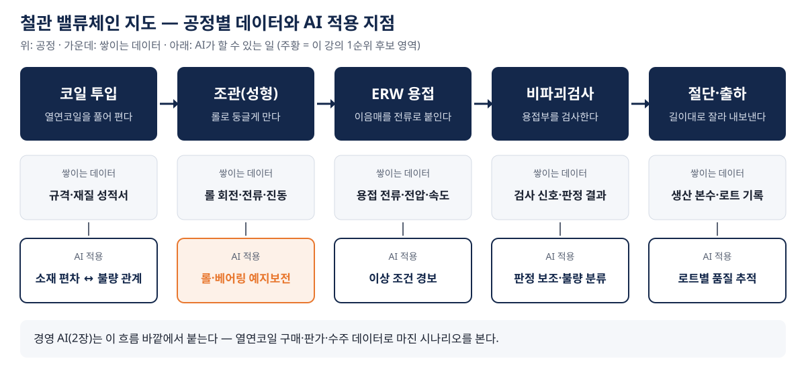

# 1장. 제조 AI — 조관기와 용접 라인이 보내는 신호를 읽는다

> **핵심 질문** — 조관·용접 현장에서 AI가 불량과 설비 고장을 얼마나 미리 알려 줄 수 있는가?

---

## ① 용어와 '왜'

### 용어

| 용어 | 뜻 |
|---|---|
| 조관 | 열연코일을 풀어 롤로 둥글게 말아 관 모양을 만드는 공정. 그 설비가 조관기 |
| ERW 용접 | 전기저항용접. 둥글게 만든 강판의 이음매를 전류로 붙인다 |
| 예지보전 | 고장 나기 전에 신호를 읽고, 정말 필요할 때 계획 정비하는 방식 |
| 평상 범위 | 평균 ± 2표준편차. 이 범위를 벗어난 값을 "이상 후보"로 본다 |
| 노이즈 | 한 번 튀었다가 바로 돌아오는 값 |
| 추세적 상승 | 여러 번에 걸쳐 꾸준히 오르는 흐름. 진짜 정비 신호 |
| 암묵지 | 숙련자의 몸에 밴, 말이나 문서로 옮기기 어려운 판단 |

### 왜 제조 AI부터 보는가

철관 라인은 한 줄로 이어져 있다. 조관기 하나가 서면 용접·검사·절단이 함께 선다. 원본 강의(Day5 예지보전)의 말대로 "고장을 미리 아는 것은 비용이 아니라 생존"이다.

| 기준 | 지금까지 | 제조 AI를 붙이면 |
|---|---|---|
| 이상을 아는 시점 | 고장이 나거나, 숙련 기사가 소리로 알아챌 때 | 진동·전류 기록이 오르기 시작할 때 |
| 판단 기준 | 사람마다 다른 감 | 누구나 같은 선(평상 범위)과 흐름 |
| 숙련자가 떠나면 | 감도 함께 사라진다 | 판단이 데이터로 남는다 |

---

## ② 본문

### 그림 1. 철관 밸류체인 지도 — AI가 들어갈 자리

*그림 1. 열연코일 투입부터 출하까지 공정별로 쌓이는 데이터와 AI 적용 지점. 강의 교재용으로 정리한 개념도이며 수치는 없다.*

공정마다 쌓이는 데이터가 다르고, AI가 할 수 있는 일도 다르다.

| 공정 | 쌓이는 데이터 | AI가 할 수 있는 일 | 우리 공장에서 확인할 것 |
|---|---|---|---|
| 코일 투입 | 코일 규격·재질 성적서 | 소재 편차와 뒤 공정 불량의 관계 찾기 | 성적서가 전산으로 보관되는가 |
| 조관(성형) | 롤 회전수, 모터 전류, 진동 | 롤·베어링 마모를 미리 알리기 (예지보전) | 진동 센서가 달려 있고 기록이 남는가 |
| ERW 용접 | 용접 전류·전압·속도 | 이상 용접 조건 경보, 조건과 불량의 관계 찾기 | 설비 기록을 얼마나 오래 보관하는가 |
| 비파괴검사 | 검사 신호, 판정 결과 | 판정 보조, 불량 유형 분류 | 판정 결과와 원신호를 함께 보관하는가 |
| 절단·출하 | 생산 본수, 로트 기록 | 로트별 품질 추적 | 로트 번호로 공정 기록을 이어 볼 수 있는가 |

국내 강관 ERW 용접부에 AI 검사를 도입해 성과를 공개한 사례는 이번 조사에서 찾지 못했다(미확보). 그래서 사례는 같은 철강 현장인 제철소에서 가져온다.

### 보전 방식의 네 단계

원본 강의(Day5)는 유지보수가 네 단계로 진화한다고 정리한다.

| 단계 | 언제 정비하나 | 장점 | 한계 |
|---|---|---|---|
| ① 사후 정비 | 고장 난 뒤 | 준비가 필요 없다 | 정지·손실이 가장 크다 |
| ② 예방 정비 | 정해진 주기마다 | 계획을 세울 수 있다 | 멀쩡한 부품도 바꾼다 |
| ③ 예측 정비(예지보전) | 신호가 보일 때 | 필요할 때만 정비한다 | 데이터와 판정 기준이 있어야 한다 |
| ④ 처방 정비 | AI가 조치까지 제안할 때 | 판단 시간을 줄인다 | 예측이 안정된 뒤에야 가능하다 |

예지보전 효과를 "정지 시간 몇 % 감소"처럼 하나의 숫자로 말하는 2차 인용 자료는 있지만 서로 숫자가 달랐고, 원문까지 확인한 공신력 있는 최근 수치는 찾지 못했다(미확보). 그래서 이 교재는 일반 효과 수치 대신 **우리 공장 파일럿에서 직접 잰 숫자**를 성과 기준으로 삼자고 권한다(3장).

### 신호를 읽는 법 — 한 점이 아니라 흐름

원본 강의의 세 번째 메시지가 판단의 핵심이다.

> **한 번의 튐(노이즈)이 아니라 추세적 상승이 진짜 신호다.**

| 신호 모양 | 판단 | 할 일 |
|---|---|---|
| 한 번 크게 튀고 바로 돌아옴 | 노이즈 | 센서·기록 오류부터 확인, 라인은 세우지 않는다 |
| 평상 범위 안에서 꾸준히 오름 | 추세의 시작 | 오르기 시작한 시점을 근거로 다음 계획 정비에 넣는다 |
| 진동과 불량률이 함께 오름 | 더 강한 신호 | 정비를 앞당기고 원인을 함께 본다 |

평상 범위는 출발점일 뿐이다. 완만하게 오르는 흐름은 범위를 넘기 한참 전에 시작된다. 범위를 넘을 때까지 기다리면 계획 정비의 기회를 놓친다.

---

## ③ 케이스 — 제철소가 "보는 법"을 바꾸다

**암묵지가 데이터가 되다.** 원본 강의(Day5)는 사람이 들여다볼 수 없는 제철소 고로 이야기로 시작한다. 명장들은 불꽃 색과 소리로 고로 상태를 읽었고, 그 감은 퇴직과 함께 사라졌다. 센서와 조업 데이터로 이 판단을 학습시킨 포스코는 2019년 7월 세계경제포럼(WEF) 등대공장으로 선정됐고, "국내 기업이 등대공장으로 선정된 것은 처음"이었다 [S1]. *(기간 밖 자료 — 배경으로만 쓴다.)* 현장의 말은 이랬다 — "우리는 설비를 바꾼 게 아니라, 보는 법을 바꿨다."

**최근의 변화.** 포항제철소는 설비 이상 예측 시스템(PIMS)을 연주공정 유압 밸브에 적용해 2024년에 "10여건의 설비 장애를 사전 예지"했다 [S2]. 예지정비 조직을 운영한 뒤에는 "지난 8월 기준 설비장애로 인한 긴급정비 건수는 전년 동기 대비 약 50% 감소"했다(2026년 8월 기준) [S3].

**임원이 읽어야 할 대목.** 두 수치 모두 회사가 제공한 내용을 언론이 전한 것이고, 다른 출처로 교차 확인되지 않았다. 또 [S3]의 50%는 "설비장애"가 아니라 "긴급정비 건수"의 감소이고, 같은 기사에서 AI 기반 이상 예측 시스템은 아직 개발 계획 단계다. **조직 개선 효과와 AI 효과를 나눠 보지 않으면 AI 성과를 부풀리게 된다.**

**세계의 흐름.** WEF 등대공장 네트워크는 2025년 9월 12곳이 새로 들어와 전체 201곳이 됐고 [S4], 2026년 1월에는 23곳이 더 선정됐다 [S6]. 다만 이 중 철강 공장의 성과 수치는 확인하지 못했다(미확보).

| 사례의 교훈 | 철관 공장에 옮기면 |
|---|---|
| 열어 볼 수 없으면 둘러싼 신호를 읽어라 | 조관기 롤·베어링 안을 볼 수 없으니 진동·전류를 읽는다 |
| 암묵지를 데이터로 남겨라 | 숙련 기사의 "소리가 이상하다"를 진동 기록과 정비 이력으로 남긴다 |
| 사람은 예외와 판단으로 이동한다 | 일상 감시는 AI가, 기사는 예외 상황과 정비 판단을 맡는다 |

---

## ④ 요약

1. 철관 공장의 제조 AI는 조관기 진동·용접 기록처럼 **이미 쌓이는 데이터**에서 시작한다.
2. 판단 기준은 가장 높았던 한 점이 아니라 **오르기 시작한 시점**이다.
3. 성과 보고는 **무엇과 비교한 숫자인지, 정말 AI 효과인지** 나눠 묻는다.

---

## ⑤ 생각해 볼 질문

1. 우리 공장의 보전 방식은 사후·예방·예측·처방 중 어디에 있는가? 공정마다 다르다면 어디가 가장 뒤처져 있는가?
2. 조관기 진동이 한 번 크게 튀었다는 보고를 받았다. 라인을 세우기 전에 무엇을 먼저 확인하게 하겠는가?
3. 우리 회사에서 "소리로 아는" 숙련자는 누구인가? 그 판단을 데이터로 남기려면 무엇부터 기록해야 하는가?
4. 어떤 부서가 "예지보전으로 긴급정비가 크게 줄었다"고 보고했다. AI 효과인지 확인하려면 어떤 비교가 필요한가?

> **강의 실습 연결** — Block 1에서 가상 생산 로트 데이터로 노이즈와 추세를 직접 가려 본다.

---

## 이 장의 출처

번호는 `forge/research/sources.md`와 같고, 숫자 원문은 `forge/research/facts.csv`에 있다.

| 번호 | 출처 | 발행일 |
|---|---|---|
| S1 | 이투데이, 「포스코, 제조업 미래 선도할 '등대공장' 선정... 국내 기업 최초」 (기간 밖) | 2019-07-03 |
| S2 | 서울신문, 「스마트 시스템 구축 포스코, 철강산업에 인공지능을 입히다」 | 2025-02-24 |
| S3 | 경북매일, 「포항제철소, '예지정비 원팀' 가동...설비장애 50% 줄였다」 | 2026-10-02 |
| S4 | CGTN, 「WEF's Global Lighthouse Network welcomes 12 new members, 6 in China」 | 2025-09-18 |
| S6 | 세계경제포럼, 「Global Lighthouse Network Recognizes 23 New Sites…」 (검색으로 확인) | 2026-01-15 |
| — | 강의 저장소 keerhee/kma-auto-genai-3-1, Day5 예지보전 Main·Hook 덱 (개념·사례 서술) | — |

**미확보** — 예지보전 일반 효과(%), 국내 강관 용접부 AI 검사 성과, WEF 등대공장 중 철강 공장의 성과 수치.
