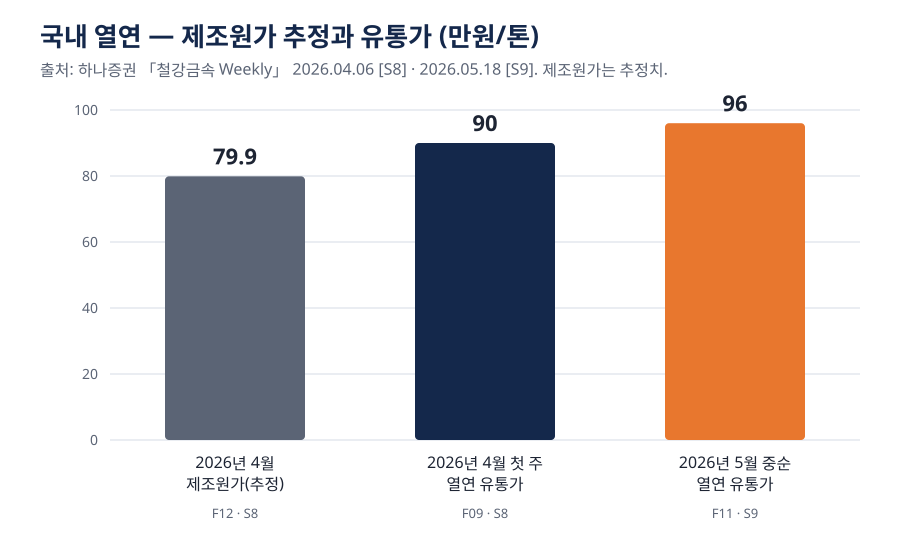

# 2장. 경영 AI — 열연코일 가격이 흔들릴 때 마진을 지킨다

> **핵심 질문** — 열연코일 가격이 흔들릴 때 우리 마진은 얼마나 흔들리고, AI로 무엇을 먼저 볼 수 있는가?

---

## ① 용어와 '왜'

### 용어

| 용어 | 뜻 |
|---|---|
| 열연코일 | 철관의 원재료. 두루마리 형태의 강판 |
| 유통가 | 유통 시장에서 거래되는 가격. 제조사 출하가와 다를 수 있다 |
| 원재료비 | 열연코일 가격 × 제품 한 톤에 드는 코일 양 |
| 스프레드 | 판가 − 원재료비. 철관 회사가 실제로 "버는 폭" |
| 영업이익률 | 영업이익 ÷ 매출. 팔아서 남기는 힘 |
| 원가 전가 | 원재료가 오른 만큼 판가를 올려 받는 것 |
| 시나리오 분석 | "코일가가 오르면?"처럼 조건을 바꿔 결과가 얼마나 흔들리는지 미리 보는 것 |

### 왜 경영 AI인가

원본 강의(Day3 경쟁사 재무)의 메시지 두 가지가 그대로 적용된다.

- **한 지표가 아니라 여러 지표를 함께 봐야 전략이 보인다.** 매출이 늘어도 스프레드가 줄면 이익은 떨어진다.
- **반복 문서는 AI에게, 해석과 한 장 요약은 사람에게.** 임원은 첫 한 장만 본다.

| 기준 | 지금까지 | 경영 AI를 붙이면 |
|---|---|---|
| 가격 변동 확인 | 월말 보고서로 사후에 안다 | 주간 시황을 바로 표로 정리한다 |
| 시나리오 | 담당자가 엑셀로 조건 하나씩 | 품목 × 가격 변동 조합을 회의 중에 바로 본다 |
| 사람이 할 일 | 숫자 모으기 | 판가 협상·품목 조정 같은 결정 |

---

## ② 본문

### 2026년 4~5월 국내 열연 가격 — 한 달여 사이에 올랐다

증권사 주간 보고서에 따르면 국내 열연 유통가는 2026년 4월 첫 주에 톤당 90만원으로 한 주 전보다 3.4% 올랐다 [S8]. 같은 보고서는 "90만원대는 2년 6개월 만"이라고 전했다 [S8]. 5월 중순에는 톤당 96만원이었다 [S9].

### 그림 2. 열연 제조원가 추정과 유통가

*그림 2. 2026년 4월 열연 제조원가 추정(79만 9,000원/톤)과 국내 열연 유통가(4월 첫 주 90만원/톤, 5월 중순 96만원/톤) [S8][S9]. 출처: 하나증권 「철강금속 Weekly」 2026.04.06, 2026.05.18. 제조원가는 추정치다.*

| 시점 | 항목 | 값 | 출처 |
|---|---|---|---|
| 2026년 4월 | 열연 제조원가 (추정) | 79만 9,000원/톤 | [S8] |
| 2026년 4월 첫 주 | 국내 열연 유통가 | 90만원/톤 | [S8] |
| 2026년 5월 중순 | 국내 열연 유통가 | 96만원/톤 | [S9] |

**주의할 점.** 세 값 모두 같은 증권사 보고서 계열이라 다른 기관의 자료로는 교차 확인하지 못했다. 공식 통계(한국은행 생산자물가지수 등)와의 비교는 이번 조사에서 하지 못했다(미확보).

### 철관 회사에게 코일가가 무서운 이유

코일가가 오르면 철관 회사는 둘 중 하나를 해야 한다 — 판가를 올리거나, 줄어든 스프레드를 견디거나. 문제는 판가를 올릴 수 있는지가 **수요**에 달려 있다는 점이다.

| 상황 | 판가 인상 | 결과 |
|---|---|---|
| 수요가 강할 때 | 원가 상승분을 대부분 전가 | 스프레드 유지 |
| 수요가 약하고 경쟁이 심할 때 | 일부만 전가하거나 못 함 | 스프레드 축소 → 이익 감소 |
| 수출 시장에 관세가 붙을 때 | 관세 부담을 누가 질지 협상 | 수출 수익성 하락 |

### AI로 먼저 볼 것 세 가지

1. **가격 흐름 정리** — 주간 시황·증권사 보고서의 숫자를 매주 같은 표로 모은다.
2. **품목별 민감도** — 원재료비 비중이 큰 품목일수록 코일가에 마진이 크게 흔들린다. 품목 × 가격 변동 시나리오 표를 만든다.
3. **협상 근거** — "톤당 이익을 지키려면 판가를 얼마나 올려야 하는가"를 품목별로 계산해 영업 협상에 쓴다.

---

## ③ 케이스 — 세아제강, 원가와 관세 사이에서

증권사 분석에 따르면 세아제강의 2025년 2분기 연결 실적은 매출액 4,149억원(전년 대비 -5.6%), 영업이익 209억원(전년 대비 -41.8%)이었다 [S10]. 매출보다 영업이익이 훨씬 크게 줄었다.

**내수 — 원가를 다 넘기지 못했다.** 같은 보고서는 건설 경기 침체로 업체 간 가격 경쟁이 심해져 "원가 부담을 판가에 충분히 전가하지 못 해 내수 부문의 수익성이 악화됐다"고 분석했다 [S10]. 2장의 스프레드 이야기가 실제 숫자로 나타난 셈이다.

**수출 — 관세가 붙었다.** 수출 부문은 "관세 인상(미국향 50%) 전까지 10%대 수익성을 유지"했지만, 3분기부터 관세가 온전히 반영되면 수익성 하락이 불가피하다고 봤다 [S10]. 실제로 2025년 7월 대미 철강 수출액은 2억8341만달러로 전년 같은 달(3억8255만달러)보다 25.9% 줄었고 [S11], 수출량은 19만4000톤으로 24.3% 줄었다 [S11].

**임원이 읽어야 할 대목.**

| 숫자 | 읽는 법 |
|---|---|
| 매출 -5.6%, 영업이익 -41.8% [S10] | 매출만 보면 "조금 줄었다". 이익을 보면 "크게 흔들렸다" — 여러 지표를 함께 봐야 한다 |
| 미국향 관세 50% [S10] | 같은 제품이라도 시장별로 마진 구조가 바뀐다 — 시장 × 품목 시나리오가 필요하다 |

**주의할 점.** 세아제강 실적은 기준(연결·별도)에 따라 다르게 보도되며, 영업이익 209억원 [S10]은 다른 출처로 교차 확인하지 못했다. 강관 회사들의 최근 연간 영업이익률은 이번 조사에서 확인하지 못했다(미확보).

---

## ④ 요약

1. 2026년 4~5월 국내 열연 유통가는 톤당 90만원에서 96만원으로 올랐다 [S8][S9] — 철관 회사의 마진은 원가 전가 여부에 달려 있다.
2. 매출이 아니라 **스프레드와 영업이익률**을 함께 봐야 진짜 상황이 보인다.
3. 경영 AI의 첫 쓰임은 **품목 × 가격 변동 시나리오를 빠르게 돌려 협상·결정의 근거**를 만드는 것이다.

---

## ⑤ 생각해 볼 질문

1. 우리 회사 품목 중 원재료비 비중이 가장 큰 것은 무엇인가? 코일가가 오르면 그 품목의 마진은 얼마나 줄어드는가?
2. 지난번 코일가 상승 때 판가에 얼마나 전가했는가? 전가하지 못한 이유는 수요였나, 경쟁이었나, 계약 구조였나?
3. 매출은 늘었는데 이익이 줄었다는 보고를 받았다. 어떤 숫자를 함께 보여 달라고 하겠는가?
4. 수출 시장에 관세가 붙는다면, 관세 부담을 우리·현지 법인·고객이 어떻게 나눌지 시나리오를 미리 세워 두었는가?

> **강의 실습 연결** — Block 2에서 가상 코일가·마진 데이터로 품목별 시나리오 표를 직접 만든다.

---

## 이 장의 출처

번호는 `forge/research/sources.md`와 같고, 숫자 원문은 `forge/research/facts.csv`에 있다.

| 번호 | 출처 | 발행일 |
|---|---|---|
| S8 | 하나증권, 「철강금속 Weekly 2026.04.06」 | 2026-04-06 |
| S9 | 하나증권, 「철강금속 Weekly 2026.05.18」 | 2026-05-18 |
| S10 | 한화투자증권, 「세아제강(306200) 기업분석」 | 2025-08-18 |
| S11 | 헤럴드경제, 「7월 대미 철강 수출 26% '뚝'…50% 관세폭탄 여파」 | 2025-08-23 |
| — | 강의 저장소 keerhee/kma-auto-genai-3-1, Day3 경쟁사 재무 Main 덱 (개념 서술) | — |

**미확보** — 공식 통계(한국은행·KOSIS)의 열연 가격, 강관 회사들의 2025년 연간 영업이익률, 휴스틸 2025년 확정 실적(출처 간 충돌).
